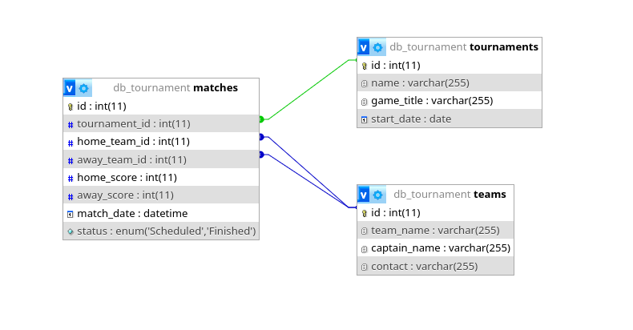

# Janji
Saya Muhammad Rian Anugrah NIM 2507241 mengerjakan Tugas Praktikum 7 pada Mata Kuliah Desain dan Pemrograman Berorientasi Objek (DPBO) untuk keberkahan-Nya maka saya tidak melakukan kecurangan seperti yang telah dispesifikasikan. Aamiin

# Esports Tournament Management System

Sistem berbasis PHP sederhana untuk mengelola data turnamen game online, data tim peserta, dan jadwal serta hasil pertandingan esports.

# Fitur Utama

Sistem ini menyediakan fungsionalitas CRUD (Create, Read, Update, Delete) lengkap untuk tiga entitas utama:

* **Turnamen (Tournaments):** Mengelola data kompetisi/turnamen (nama turnamen, judul game seperti *Mobile Legends*, *Valorant*, *Dota 2*, dan tanggal mulai pelaksanaan).
* **Tim (Teams):** Mengelola data tim peserta turnamen (nama tim, kapten tim, dan kontak/email manajemen).
* **Pertandingan (Matches):** Mengelola jadwal pertandingan antar tim dalam turnamen, mencakup turnamen terkait, tim 1 (home), tim 2 (away), skor tim 1, skor tim 2, tanggal & jam pertandingan, dan status (`Scheduled`, `Finished`).

# Struktur Proyek

Proyek ini menggunakan arsitektur MVC (Model-View-Controller) yang sederhana, di mana file Class bertindak sebagai Model (logika database), file PHP di folder `view/` bertindak sebagai View (tampilan), dan file `index.php` bertindak sebagai Controller utama untuk mengatur navigasi dan routing halaman.

```
TP7DPBO2526C2/
├── Dokumentasi/
│   └── Record.mp4
│
├── Tournament/
│   ├── class/
│   │   ├── Tournament.php
│   │   ├── Team.php
│   │   └── Match.php
│   │
│   ├── config/
│   │   └── db.php
│   │
│   ├── view/
│   │   ├── tournaments.php
│   │   ├── teams.php
│   │   └── matches.php
│   │
│   ├── dummy_data.sql
│   ├── index.php
│   └── style.css
│   │
│   ├── view/
│   │   ├── tournaments.php
│   │   ├── teams.php
│   │   └── matches.php
│   │
│   ├── dummy_data.sql
│   ├── index.php
│   └── style.css
│
├── db_tournament.sql
└── README.md
```

# Diagram


# Alur Kerja Aplikasi (Workflow)

1. **Routing dan Inisialisasi (`index.php`)**:
   - Memanggil class `Tournament`, `Team`, dan `MatchModel`.
   - Mengambil parameter query string `$_GET['option']` (default: `tournaments`).
   - Me-render navbar dan menyertakan view yang sesuai (`tournaments.php`, `teams.php`, atau `matches.php`).

2. **Pengelolaan Data (CRUD di folder `view/`)**:
   - Setiap view menangani alur berbasis parameter `$_GET['action']`:
     - **Read (Default)**: Menampilkan tabel data yang diambil melalui method getter pada class model (`getTournament()`, `getTeam()`, `getMatch()`).
     - **Create**: Menampilkan form penambahan data, memproses request `POST`, memanggil method `add...()`, lalu me-redirect kembali ke halaman utama tabel.
     - **Update**: Mengambil data spesifik berdasarkan `$_GET['id']` dengan method `getById()`, menampilkan form berisi data lama, memproses request `POST`, memanggil method `update...()`, lalu me-redirect.
     - **Delete**: Menerima request `$_GET['action']=delete&id=...`, memanggil method `delete...()`, lalu me-redirect kembali ke daftar tabel.

3. **Database Wrapper & PDO (`config/db.php`)**:
   - Menyediakan class `Database` yang menginisialisasi koneksi `PDO` ke MySQL dengan mode error exception.
   - Digunakan oleh constructor pada setiap class model untuk mengeksekusi prepared statements dengan aman.

# Dokumentasi
https://github.com/user-attachments/assets/d51001b5-90a9-48db-9265-7c9bfad8b1d5
